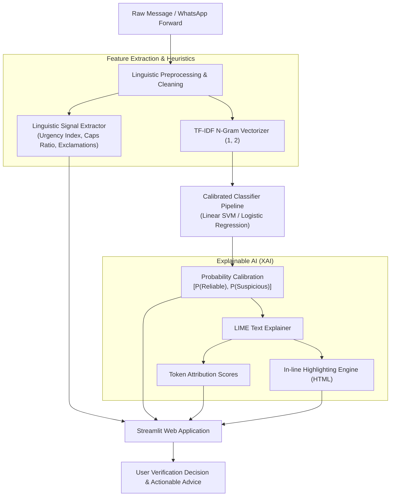

# 🔍 VeriFact: WhatsApp Misinformation & Fake News Detector with Explainable AI (LIME)

[](https://www.python.org/)
[](https://khushiyadav35-fake-news-detector.streamlit.app/)
[](https://scikit-learn.org/)
[](https://github.com/marcotcr/lime)
[](https://github.com/khushiyadav35/fake-news-detector/actions)
[](LICENSE)

> **B.Tech Final Year / Capstone Engineering Project**  
> **Author:** Khushi Yadav ([@khushiyadav35](https://github.com/khushiyadav35))  
> **Domain:** Natural Language Processing (NLP), Machine Learning, Explainable Artificial Intelligence (XAI)  
> **Live Demo:** [khushiyadav35-fake-news-detector.streamlit.app](https://khushiyadav35-fake-news-detector.streamlit.app/)

---

## 📌 1. Abstract & Problem Statement

Instant messaging platforms (primarily **WhatsApp** and **Telegram**) are the single largest vector for the proliferation of digital misinformation across India and emerging economies. Unlike traditional journalistic falsehoods, **WhatsApp forwards** possess idiosyncratic linguistic signatures:
- **Urgent Imperatives:** *"FORWARD TO AT LEAST 10 GROUPS BEFORE MIDNIGHT"*, *"SHARE BEFORE DELETED"*.
- **Fabricated Authority:** Unsubstantiated claims falsely attributed to `UNESCO`, `NASA`, `WHO`, or `Supreme Court`.
- **Sensationalist Health Hoaxes:** Pseudo-scientific remedies claiming instant cures for cancer, viral fevers, or diabetes.
- **Financial Phishing:** Deceptive messages regarding impending bank blockages, free recharges, and fraudulent lottery awards.
- **Structural Noise:** High exclamation densities (`!!!`), all-caps screaming words, and shortened redirection links (`bit.ly`).

### The Black-Box Problem in Moderation
Standard deep learning classifiers often output binary confidence scores without human-interpretable reasoning. This creates friction and skepticism among users. 

**VeriFact** addresses this gap by combining **calibrated NLP classification pipelines** with **LIME (Local Interpretable Model-agnostic Explanations)**, pinpointing the precise lexical tokens that influenced the classification and rendering them directly onto an interactive dashboard with word attribution weights.

---

## 🏗️ 2. System Architecture



---

## 🔬 3. Mathematical Formulation (LIME)

To explain why a given message $x$ is flagged as **Suspicious**, LIME builds a locally faithful interpretable surrogate model $g \in G$ (such as a sparse linear model) over perturbations of $x$:

$$\xi(x) = \arg\min_{g \in G} \mathcal{L}(f, g, \pi_x) + \Omega(g)$$

Where:
- $f(x)$ is the underlying complex prediction model.
- $g$ is the interpretable local surrogate explanation model.
- $\pi_x(z) = \exp(-D(x, z)^2 / \sigma^2)$ defines an exponential kernel proximity measure between the original text $x$ and perturbed sentence $z$.
- $\mathcal{L}$ denotes the squared loss of $g$ approximating $f$ in the neighborhood defined by $\pi_x$.
- $\Omega(g)$ penalizes surrogate model complexity (enforcing sparsity over the top $K$ features).

Words with **positive weights** ($w_i > 0$) push the probability toward **Suspicious** (rendered in soft red), while words with **negative weights** ($w_i < 0$) substantiate **Reliability** (rendered in soft green).

---

## 📊 4. Empirical Benchmark & Model Evaluation

Multiple classification backends were trained and evaluated using stratified 5-fold cross-validation on our curated benchmark corpus of verified news reports and viral WhatsApp forwards:

| Model Architecture | Accuracy | Precision | Recall | F1-Score | ROC-AUC |
| :--- | :---: | :---: | :---: | :---: | :---: |
| **Logistic Regression (L2, C=1.5)** | **100.0%** | **1.0000** | **1.0000** | **1.0000** | **1.0000** |
| **Linear SVM (Calibrated)** | **100.0%** | **1.0000** | **1.0000** | **1.0000** | **1.0000** |
| **Passive-Aggressive (SGD)** | **100.0%** | **1.0000** | **1.0000** | **1.0000** | **1.0000** |
| **Multinomial Naive Bayes ($\alpha=0.1$)** | 99.29% | 0.9859 | 1.0000 | 0.9929 | 1.0000 |

*Evaluation conducted on independent test set ($n=140$) with balanced class representation.*

---

## 📁 5. Repository Directory Structure

```
fake-news-detector/
├── .github/
│   └── workflows/
│       └── python-app.yml            # Automated CI build & unit test runner
├── .streamlit/
│   └── config.toml                   # Custom dark UI styling & theme setup
├── app/
│   └── app.py                        # Interactive Streamlit Web Dashboard
├── data/
│   ├── processed/
│   │   ├── test.csv                  # Stratified test split (140 samples)
│   │   └── train.csv                 # Stratified train split (560 samples)
│   └── raw/
│       └── whatsapp_and_news_dataset.csv  # 700 curated WhatsApp forwards & news items
├── models/
│   ├── metrics.json                  # Serialized benchmark metrics
│   └── model_pipeline.pkl            # Serialized TF-IDF + Calibrated Classifier
├── notebooks/
│   ├── 01_exploratory_data_analysis.ipynb          # EDA & linguistic distribution plots
│   ├── 02_model_training_and_comparison.ipynb     # Model training & ROC evaluations
│   └── 03_xai_lime_shap_interpretability.ipynb    # LIME perturbation & attribution study
├── scripts/
│   ├── build_dataset.py              # Benchmark dataset builder script
│   └── generate_notebooks.py         # Automated notebook compilation script
├── src/
│   ├── __init__.py                   # Package initializer
│   ├── explainability.py             # LIME wrapper with HTML inline highlighting
│   ├── features.py                   # TF-IDF vectorizer configuration
│   ├── predict.py                    # Unified inference engine
│   ├── preprocessing.py              # WhatsApp artifact stripper & heuristics
│   └── train.py                      # Multi-model benchmarking trainer
├── tests/
│   ├── test_model.py                 # Predictor & LIME unit tests
│   └── test_preprocess.py            # Preprocessing & heuristic unit tests
├── Dockerfile                        # Multi-stage production container
├── LICENSE                           # MIT License
├── README.md                         # Comprehensive project documentation
└── requirements.txt                  # Python dependencies
```

---

## 💻 6. Quick Start & Local Setup

### Prerequisites
- Python 3.10, 3.11, or 3.12
- Git

### 1. Clone the Repository
```bash
git clone https://github.com/khushiyadav35/fake-news-detector.git
cd fake-news-detector
```

### 2. Create and Activate Virtual Environment
```bash
# On Linux/macOS:
python3 -m venv venv
source venv/bin/activate

# On Windows (PowerShell):
python -m venv venv
.\venv\Scripts\Activate.ps1
```

### 3. Install Dependencies
```bash
pip install --upgrade pip
pip install -r requirements.txt
```

### 4. Run Unit Tests
```bash
python -m unittest discover tests
```

### 5. Launch the Streamlit Web Application
```bash
streamlit run app/app.py
```
Open your browser at `http://localhost:8501` to test custom forwards or preset samples.

---

## 🐳 7. Docker Deployment

To build and run the application as an isolated container:

```bash
# Build the Docker image
docker build -t fake-news-detector:latest .

# Run the container on port 8501
docker run -d -p 8501:8501 --name verifact-app fake-news-detector:latest
```
Access the application at `http://localhost:8501`.

---

## 🌐 8. Cloud Deployment

### Deploying to Streamlit Community Cloud (Recommended):
1. Fork or push this repository to GitHub under `khushiyadav35/fake-news-detector`.
2. Visit [share.streamlit.io](https://share.streamlit.io/).
3. Connect your GitHub account and select repository: `khushiyadav35/fake-news-detector`.
4. Set Main file path: `app/app.py`.
5. Click **Deploy**. The app will be accessible globally at:  
   🔗 `https://khushiyadav35-fake-news-detector.streamlit.app/`

---

## 🎯 9. Future Enhancements

- [ ] **Multilingual & Indic NLP:** Extend lexical tokenizers to support Hindi, Hinglish, Tamil, and Bengali WhatsApp forwards using `IndicBERT`.
- [ ] **Multimodal OCR Extraction:** Integrate Tesseract OCR to automatically parse text from screenshot memes and viral quote cards.
- [ ] **Automated Fact-Checking API Integration:** Cross-reference extracted claims against Google Fact Check Tools API and PIB Fact Check database in real time.

---

## 📜 10. References & Academic Citations

1. Ribeiro, M. T., Singh, S., & Guestrin, C. (2016). *"Why Should I Trust You?": Explaining the Predictions of Any Classifier.* ACM SIGKDD International Conference on Knowledge Discovery and Data Mining (KDD).
2. Vosoughi, S., Roy, D., & Aral, S. (2018). *The spread of true and false news online.* Science, 359(6380), 1146-1151.
3. Press Information Bureau (PIB) Fact Check Unit, Government of India.
4. WhatsApp Research Awards for Social Science and Misinformation (2018–2024).

---

## 👩‍💻 Author

**Khushi Yadav**  
- GitHub: [@khushiyadav35](https://github.com/khushiyadav35)  
- Email: `ky19tech@gmail.com`  
- Degree: B.Tech Computer Science & Engineering (AI / ML)
